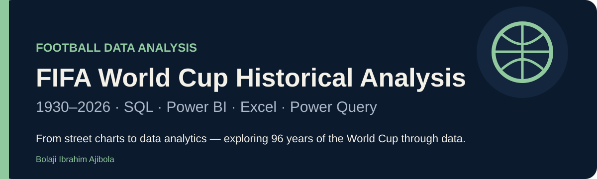

<p align="center">
  
</p>

# FIFA World Cup Historical Analysis (1930–2026)

**From Street Charts to Data Analytics**

**Bolaji Ibrahim Ajibola** · Football Data Analyst  
**PostgreSQL · Power BI · Excel · Power Query**

An end-to-end football analytics project examining how the FIFA World Cup has evolved across tournament scale, scoring, attendance, national-team performance and African participation.

[Dataset](data/Final_FIFA_WorldCup_DATASETS_1930_2026_SQL_READY.xlsx) · [SQL analysis](sql/01_analysis.sql) · [Validation checks](sql/00_validation.sql) · [Methodology](docs/methodology.md) · [Data model](docs/data-model.md) · [Portfolio](https://ibrahimbolaji.framer.website/)

---

## Project objective

This project connects **data preparation → SQL analysis → Power BI storytelling** to build a structured historical view of the FIFA World Cup.

| Question | Analytical approach |
| --- | --- |
| How has the World Cup changed over time? | Compare teams, matches, goals and scoring rates across editions and eras. |
| Which nations sustain success? | Compare titles, top-two finishes, wins, goal difference and standardised points. |
| How have scoring patterns evolved? | Recalculate goals per match and compare weighted era scoring rates. |
| What does attendance reveal? | Compare total attendance, attendance per match and changes between editions. |
| How have African nations performed? | Compare participation, match records, scoring and best recorded positions. |
| Which matches and players stand out? | Review high-scoring matches and award timelines. |

---

## Project scope

The project covers the completed FIFA World Cup tournaments from **1930 through 2026**, including the expanded 48-team edition hosted by Canada, Mexico and the United States.

---

## Data model

| Table | Intended role |
| --- | --- |
| `worldcup_summary` | One row per tournament edition |
| `worldcup_matches` | Match-level results |
| `worldcup_nations_history` | Team-by-edition performance |
| `worldcup_attendance` | Edition-level attendance |
| `worldcup_awards` | Tournament awards |
| `worldcup_goals` | Coverage checks for scoring data |
| `country_lookup` | Historical-name and regional mapping |

See the full [data model](docs/data-model.md) for expected grain, fields, keys and join considerations.

---

## Dataset

The cleaned SQL-ready workbook used for this project is included in the repository:

**[Final_FIFA_WorldCup_DATASETS_1930_2026_SQL_READY.xlsx](data/Final_FIFA_WorldCup_DATASETS_1930_2026_SQL_READY.xlsx)**

It contains the prepared historical tournament data from 1930 through 2026 used for PostgreSQL validation, SQL analysis and Power BI development.

---

## Tools and workflow

**Research & collation → Excel / Power Query → country-name standardisation & checks → PostgreSQL validation → SQL analysis → Power BI → written interpretation**

| Tool | Role |
| --- | --- |
| Excel | Source collation and structured working files |
| Power Query | Cleaning, transformation and field preparation |
| PostgreSQL | Validation, aggregation, joins and analytical queries |
| Power BI | Measures, interactive visuals and dashboard storytelling |

---

## SQL analysis

### Validation checks

[sql/00_validation.sql](sql/00_validation.sql) checks:

- source-table and tournament-edition coverage;
- duplicate tournament years;
- missing or duplicate match IDs;
- duplicate team-edition keys;
- match and goal reconciliation;
- team accounting consistency;
- missing country mappings;
- conflicting regional classifications;
- missing or negative scores.

### Selected analysis

[sql/01_analysis.sql](sql/01_analysis.sql) contains nine selected analyses:

1. Tournament coverage
2. Tournament development
3. Era comparison
4. Titles and top-two finishes
5. Team performance
6. Highest-scoring matches
7. Attendance
8. Awards
9. African team records

---

## Dashboard story

The Power BI report is structured around nine analytical pages:

1. **Overview** — tournament scale, match volume, goals, scoring rate and attendance.
2. **Historical Dominance** — titles, podium finishes, final appearances and sustained success.
3. **Host & Expansion** — host nations, co-hosting and geographic expansion.
4. **Goals Analysis** — scoring trends, high-scoring tournaments and match records.
5. **Attendance & Venue** — crowd growth, attendance per match and stadium usage.
6. **Team Analysis** — results, experience, win rate, goals and points.
7. **African Nations** — participation, results, scoring and campaign quality.
8. **World Cup Awards** — award history and individual honours.
9. **Regional Analysis** — regional outcomes, goal output, win rates and final conversion.

---

## Methodology notes

- Historical team labels are preserved rather than silently merging successor states.
- Era scoring is calculated from total goals divided by total matches.
- Standardised points use **3 × wins + draws** for comparison and are not historical official points.
- Attendance-per-match calculations depend on matching attendance totals to corresponding match counts.

Read the full [methodology](docs/methodology.md).

---

## Repository structure

```text
fifa-world-cup-historical-analysis/
├── README.md
├── assets/
│   └── world-cup-hero.svg
├── data/
│   └── Final_FIFA_WorldCup_DATASETS_1930_2026_SQL_READY.xlsx
├── docs/
│   ├── dashboard-guide.md
│   ├── data-model.md
│   └── methodology.md
└── sql/
    ├── 00_validation.sql
    └── 01_analysis.sql
```

---

## Author

**Bolaji Ibrahim Ajibola**  
Football Data Analyst · PostgreSQL · Power BI

[Portfolio](https://ibrahimbolaji.framer.website/) · [LinkedIn](https://www.linkedin.com/in/ajibola-bolaji/) · [GitHub](https://github.com/bj985)

---

## More football analytics

- [AFCON Historical Performance Analysis](https://github.com/bj985/afcon-historical-performance-analysis) — competitive balance, regional dominance, hosting, player achievement and attendance analysis.

---

### Disclaimer

This is an independent analytical project and is not affiliated with FIFA. Third-party data, trademarks and imagery retain their respective rights and reuse conditions.
