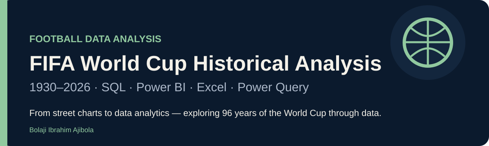

  

# FIFA World Cup Historical Analysis (1930–2026)

**From Street Charts to Data Analytics**

**Bolaji Ibrahim Ajibola** · Football Data Analyst  
**PostgreSQL · Power BI · Excel · Power Query**

An independent football analytics project exploring how the FIFA World Cup has evolved across tournament scale, scoring, attendance, national-team performance and African participation.

> The goal is not simply to display football statistics. It is to make the analytical questions, preparation decisions, SQL logic and visual story visible.

[SQL analysis](sql/01_analysis.sql) · [Validation checks](sql/00_validation.sql) · [Methodology](docs/methodology.md) · [Data model](docs/data-model.md) · [Portfolio](https://ibrahimbolaji.framer.website/)

---

## Project objective

Build a structured historical analysis of the World Cup that connects **data preparation → SQL analysis → Power BI storytelling**.

| Question | Analytical approach |
| --- | --- |
| How has the World Cup changed over time? | Compare teams, matches, goals and scoring rates across editions and eras. |
| Which nations sustain success? | Compare titles, top-two finishes, wins, goal difference and standardised points. |
| How have scoring patterns evolved? | Recalculate goals per match and compare weighted era scoring rates. |
| What does attendance reveal? | Compare total attendance, attendance per match and changes between editions. |
| How have African nations performed? | Compare participation, match records, scoring and best recorded positions. |
| Which matches and players stand out? | Review high-scoring matches and award timelines. |

---

## Project scope

**1930–2026.** The project began with historical data through 2022 and was later expanded with a 2026 project layer.

Historical records and any 2026 scenario, simulated or manually supplied records should remain clearly distinguishable in interpretation and presentation.

---

## Data model

| Table | Intended role |
| --- | --- |
| worldcup_summary | One row per tournament edition |
| worldcup_matches | Match-level results |
| worldcup_nations_history | Team-by-edition performance |
| worldcup_attendance | Edition-level attendance |
| worldcup_awards | Tournament awards |
| worldcup_goals | Coverage checks for scoring data |
| country_lookup | Historical-name and regional mapping |

See the full [data model](docs/data-model.md) for expected grain, fields, keys and join considerations.

---

## Tools and workflow

**Research & collation → Excel / Power Query → country-name standardisation & checks → PostgreSQL validation → SQL analysis → Power BI → written interpretation**

| Tool | Role |
| --- | --- |
| Excel | Source collation and structured working files |
| Power Query | Cleaning, transformation and field preparation |
| PostgreSQL | Validation, aggregation, joins and analytical queries |
| Power BI | Measures, interactive visuals and dashboard storytelling |

---

## SQL analysis

### Validation checks

[sql/00_validation.sql](sql/00_validation.sql) checks:

- source-table coverage and explicit 2026 row counts;
- duplicate tournament years;
- missing or duplicate match IDs;
- duplicate team-edition keys;
- match and goal reconciliation;
- team accounting consistency;
- missing country mappings;
- conflicting regional classifications;
- missing or negative scores.

### Selected analysis

[sql/01_analysis.sql](sql/01_analysis.sql) contains nine selected analyses:

1. Tournament coverage
2. Tournament development
3. Era comparison
4. Titles and top-two finishes
5. Team performance
6. Highest-scoring matches
7. Attendance
8. Awards
9. African team records

The SQL demonstrates joins, aggregations, conditional logic, common table expressions, window functions, numeric division and zero-denominator handling.

---

## Dashboard story

### Tournament evolution
How participation, match volume and scoring changed as the competition expanded.

### Historical dominance
Which national teams repeatedly reached the top of the tournament, and how title counts compare with broader performance.

### Goals and match patterns
How scoring rates changed across editions, plus the highest-scoring recorded matches.

### Attendance
How total crowds and per-match attendance changed across World Cup editions.

### African nations
How African teams compare on participation, results, scoring and best recorded positions.

### 2026 project extension
A dedicated layer for the expanded 2026 project data. This should be labelled according to the evidence status of the records used.

---

## Dashboard preview

### 01 · Overview

  

The overview brings tournament scale, match volume, goals, scoring rate, champion count and attendance into one entry point, supported by tournament-growth and historical trend visuals.

### Analytical pages

<table>
<tr>
<td width="50%" valign="top">
<strong>02 · Historical Dominance</strong>  
 
Titles, podium finishes, final appearances and final-conversion patterns.
</td>
<td width="50%" valign="top">
<strong>03 · Host & Expansion</strong>  
 
Host nations, co-hosting, regional distribution and the geographic expansion of the tournament.
</td>
</tr>
<tr>
<td width="50%" valign="top">
<strong>04 · Goals Analysis</strong>  
 
Scoring intensity, highest-scoring tournaments, match records and goals by competition stage.
</td>
<td width="50%" valign="top">
<strong>05 · Attendance & Venue</strong>  
 
Attendance growth, high-attendance matches, stage-level crowds and stadium usage.
</td>
</tr>
<tr>
<td width="50%" valign="top">
<strong>06 · Team Analysis</strong>  
 
Match outcomes, experience versus win rate, goals for and against, and comparative points.
</td>
<td width="50%" valign="top">
<strong>07 · African Nations</strong>  
 
Participation, campaign quality, match outcomes, scoring and the growth of African representation.
</td>
</tr>
<tr>
<td width="50%" valign="top">
<strong>08 · World Cup Awards</strong>  
 
Golden Boot, Golden Ball, Golden Glove, young-player and fair-play award history.
</td>
<td width="50%" valign="top">
<strong>09 · Regional Analysis</strong>  
 
Regional match outcomes, podiums, goal output, win rates and final-conversion comparisons.
</td>
</tr>
</table>

> **2026 scope note:** the project includes a dedicated 2026 layer. Its evidence status should remain clearly labelled wherever 2026 records are scenario-based, simulated or manually supplied.

See the [dashboard publishing guide](docs/dashboard-guide.md).

---

## Methodology notes

- Historical team labels are preserved rather than silently merging successor states.
- Top-two finishes are not automatically treated as identical to appearances in a modern single-final format.
- Era scoring is calculated from total goals divided by total matches.
- Standardised points use 3 × wins + draws for comparison and are not historical official points.
- Attendance-per-match calculations depend on matching attendance totals to corresponding match counts.
- African comparisons use the project lookup table and should be preceded by mapping-quality checks.

Read the full [methodology](docs/methodology.md).

---

## Repository structure

    fifa-world-cup-historical-analysis/
    ├── README.md
    ├── assets/
    │   ├── README.md
    │   └── world-cup-hero.svg
    ├── docs/
    │   ├── dashboard-guide.md
    │   ├── data-model.md
    │   └── methodology.md
    └── sql/
        ├── 00_validation.sql
        └── 01_analysis.sql

---

## Reproducibility status

This repository currently publishes the analytical SQL and project documentation.

The final schema export, permitted datasets, verified query outputs, Power BI model, dashboard screenshots and public dashboard link still need to be added before the project can be reproduced from an empty database.

Both SQL scripts use read-only transactions and end with ROLLBACK.

---

## Next publication steps

- [ ] Add clean Power BI dashboard screenshots
- [ ] Add the verified public Power BI link
- [ ] Publish permitted source datasets or documented import instructions
- [ ] Add verified query-output examples
- [ ] Clearly label the status of 2026 records
- [ ] Add the final written report when complete

---

## Author

**Bolaji Ibrahim Ajibola**  
Football Data Analyst · Data Storytelling & Match Video Analysis

[Portfolio](https://ibrahimbolaji.framer.website/) · [LinkedIn](https://www.linkedin.com/in/ajibola-bolaji/) · [GitHub](https://github.com/bj985)

---

### Disclaimer

This is an independent analytical project and is not affiliated with FIFA. Third-party data, trademarks and imagery retain their respective rights and reuse conditions.